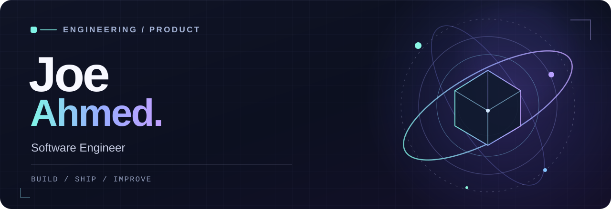

 

<a href="https://x.com/joe_ahmed_"><b>𝕏 &nbsp; @joe_ahmed_</b></a>
&nbsp;&nbsp; · &nbsp;&nbsp;
<a href="mailto:youssefahmedabdelfattah@outlook.com"><b>Email</b></a>
&nbsp;&nbsp; · &nbsp;&nbsp;
<a href="https://qabilah.com"><b>Qabilah ↗</b></a>

 

### Hey, I'm Joe 👋

I'm a software engineer who enjoys building products end to end — from the architecture behind the scenes to the experiences people interact with.

 

### Right now

**Software Engineer at [Qabilah](https://qabilah.com)**  
Building and shipping software with the Qabilah team.

 

### Certification

**☁️ AWS Certified Cloud Practitioner**  
Credential ID: `32ffaaf7f54b425ba46d60e640bb7ece`

 

---

Good software is built one thoughtful decision at a time.
